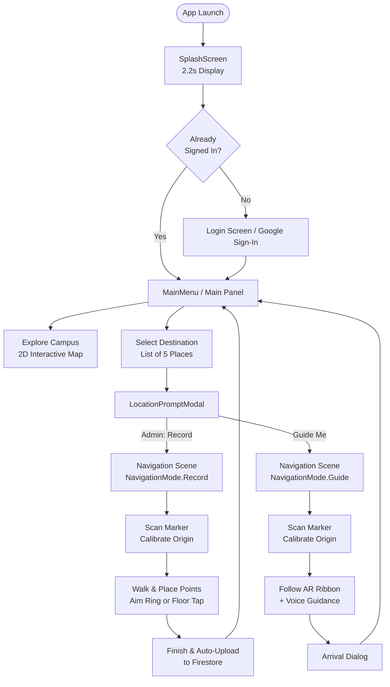

# Waypoint (BMU AR) — Comprehensive Architecture & Developer Guide
*A complete "fiber-to-fiber" reference manual for the Waypoint AR Campus Navigation repository.*

---

## Table of Contents
1. [Executive Summary & Technical Stack](#1-executive-summary--technical-stack)
2. [High-Level Architecture & Scene Flow](#2-high-level-architecture--scene-flow)
3. [All Screens & User Interface Systems](#3-all-screens--user-interface-systems)
4. [Everything You Need to Know About Vuforia in This Repo](#4-everything-you-need-to-know-about-vuforia-in-this-repo)
5. [AR Path Recording Engine](#5-ar-path-recording-engine)
6. [Real-Time AR Guidance & Path Mathematics](#6-real-time-ar-guidance--path-mathematics)
7. [Voice Guidance System](#7-voice-guidance-system)
8. [Procedural AR Rendering (Ribbons & Beacons)](#8-procedural-ar-rendering-ribbons--beacons)
9. [2D Interactive Campus Map (Google Maps + Live GPS)](#9-2d-interactive-campus-map-google-maps--live-gps)
10. [Authentication, Roles & Cloud Sync (Firebase & Firestore)](#10-authentication-roles--cloud-sync-firebase--firestore)
11. [Diagnostics, Session Logs & Crash Reporting](#11-diagnostics-session-logs--crash-reporting)
12. [Automated Editor Setup Tool (`BMUARRSetup.cs`)](#12-automated-editor-setup-tool-bmuarrsetupcs)
13. [Complete Script Catalog & API Reference](#13-complete-script-catalog--api-reference)
14. [Developer Onboarding & Step-by-Step Workflow](#14-developer-onboarding--step-by-step-workflow)

---

## 1. Executive Summary & Technical Stack

### What is Waypoint?
**Waypoint** (originally created under the internal code name `BMUARR`) is a production-grade Augmented Reality (AR) mobile campus navigation system developed specifically for **BML Munjal University (BMU)** in Gurugram, India (Coordinates: `28.2479° N, 76.8134° E`).

The app solves the problem of finding indoor and outdoor locations across campus without relying on fragile GPS signals indoors. It uses physical image markers (anchor targets) to establish a centimeter-accurate, gravity-aligned local coordinate origin, and provides turn-by-turn visual ribbons on the ground, interactive 3D pins, voice prompts, and an interactive 2D overview campus map.

```
+-----------------------------------------------------------------------------------+
|                                  WAYPOINT APP                                     |
+-----------------------------------------+-----------------------------------------+
|            MainMenu.unity               |            Navigation.unity             |
|   (2D UI, Auth, Map, Destinations)      |     (AR Camera, Marker Tracking, HUD)   |
+-----------------------------------------+-----------------------------------------+
| - Splash & Onboarding                   | - Vuforia Engine AR Tracking            |
| - Google Auth & Role Verification       | - Gravity-Aligned Anchor Calibration    |
| - 2D Interactive Google Campus Map      | - Procedural Ground Ribbon & Chevrons   |
| - Destination Selection (5 Waypoints)   | - Real-Time Turn & Wrong-Way Guidance   |
| - Firestore Route Sync (Download/Sync)  | - Priority Voice Guidance Queue         |
| - Crash & Diagnostics Reporting         | - Floor Tap / Crosshair Path Recording  |
+-----------------------------------------+-----------------------------------------+
```

### Technology Stack & Environment
* **Game Engine**: Unity 6 (`6000.6.2f1`)
* **Render Pipeline**: Universal Render Pipeline (URP `17.0.3`)
* **Color Space**: Linear
* **AR Platform**: Vuforia Engine (`11.4.4`) installed as a local package (`com.ptc.vuforia.engine-11.4.4.tgz`) backed by ARCore on Android
* **Input Handling**: Unity Input System (`com.unity.inputsystem 1.20.1`)
* **UI Framework**: Unity UGUI (`com.unity.ugui 2.0.0`) + TextMesh Pro (`PoetsenOne` & `LiberationSans` SDF fonts)
* **Backend Services**:
  * **Firebase Authentication** (`FirebaseAuth.dll`) with custom native Android bridge for Google Sign-In
  * **Cloud Firestore REST API** (custom lightweight implementation over `UnityWebRequest` to eliminate heavy client SDK overhead)
  * **Google Maps Platform**: Static Maps API (custom mint styling) + Routes API (walking polyline directions)
* **Target Platform**: Android 11+ (API Level 30+), 64-bit ARM (`ARM64`), IL2CPP scripting backend, Vulkan graphics API.

---

## 2. High-Level Architecture & Scene Flow

The project is structured with strict scene separation to ensure that heavy AR camera and computer vision processes run **only** when active navigation is taking place.



### The Two Core Scenes:
1. **`Assets/Scenes/MainMenu.unity`**:
   - Contains a standard orthographic/black menu camera (`cullingMask = 0`).
   - Contains the primary canvas (`CanvasScaler` set to 1080×1920 portrait reference).
   - Hosts splash, authentication, user greeting header, destination list, campus 2D map, and modal dialogs.
   - **No AR Camera or computer vision runs here**, saving battery and eliminating camera permission prompts until navigation starts.

2. **`Assets/Scenes/Navigation.unity`**:
   - Contains the Vuforia `ARCamera` and `ImageTarget` objects.
   - Capped at **30 FPS** (`Application.targetFrameRate = 30`) and `Screen.sleepTimeout = NeverSleep` to conserve thermal budget while tracking.
   - Hosts the `NavigationHUD`, `GuidanceController`, `VoiceGuide`, `ARPathRenderer`, `ARPathRecorder`, `AnchorTracker`, `FloorEstimator`, and `TrackingQualityMonitor`.
   - Exiting back to menu automatically cleans up AR resources and unloads tracking from memory.

### Cross-Scene Communication: `AppSession.cs`
Because Unity scenes reload their hierarchy when loaded with `LoadSceneMode.Single`, persistent state is stored in pure C# static classes that survive scene reloads:
- `AppSession.Destination`: The name of the target campus location (e.g., `"Library"`, `"Reception"`).
- `AppSession.Mode`: Either `NavigationMode.Record` (admin creates a route) or `NavigationMode.Guide` (user follows an existing route).
- `AppSession.OnboardingComplete`: Set to `true` after login/splash so returning from AR returns directly to the main menu instead of restarting the splash screen.

---

## 3. All Screens & User Interface Systems

### Screen 1: Splash Screen (`SplashScreen.cs`)
* **Visuals**: Full-screen campus background image with the official "Ar-BMU" brand logo and a subtle pulsing label ("Find Your Way").
* **Behavior**: Displays for 2.2 seconds (`displayTime = 2.2f`).
* **Session Restoration**: When the timer elapses, `UIManager` polls `FirebaseBootstrap.IsReady`. If Firebase already has an active session from a previous launch, it calls `GoogleAuthManager.RestoreSession()` and transitions directly to `MainMenu`. If unauthenticated, it transitions to `LoginScreen`.
* **Background Replay**: If the user leaves the app in the background for more than 30 seconds (`SplashReplayAfterSeconds = 30f`) and returns, `UIManager.OnApplicationPause()` automatically replays the splash screen before showing the menu.

### Screen 2: Login & Verification (`LoginScene.cs`, `GoogleAuthManager.cs`)
* **Visuals**: Clean card interface featuring BMU branding, student illustration, and a prominent "Continue with Google" button.
* **Authentication Flow**:
  1. User taps "Continue with Google".
  2. On Android, `GoogleAuthManager` invokes the native Java bridge `com.bmu.googleauth.GoogleAuthBridge.signIn()`.
  3. The native bridge triggers Google Identity Services and passes back a callback via `UnitySendMessage("Ui Manager", "OnGoogleAuthResult", "SUCCESS|<idToken>")`.
  4. The C# layer takes the Google ID token and calls `auth.SignInWithCredentialAsync(GoogleAuthProvider.GetCredential(idToken, null))`.
  5. Upon success, `UserSession.SetSignedIn(user.DisplayName, user.Email)` parses user details and checks `AdminConfig.IsAdmin(email)`.
  6. In the Unity Editor, sign-in is mocked as a guest user with admin privileges to facilitate testing without a physical Android device.

### Screen 3: Main Dashboard (`MainPanelHeader.cs`, `CampusNavigationManager.cs`)
* **Visuals**:
  - Header: Displays "Welcome, {FirstName}!" with an account log-out button.
  - Role Badge: Displays a green **ADMIN** badge if the logged-in email is listed in `AdminConfig.asset`.
  - Action Cards: Two primary illustrated buttons:
    1. **"Explore Campus"**: Opens the 2D interactive Google Campus Map.
    2. **"Select Destination"**: Opens the destination selection catalog.

### Screen 4: Destination Catalog (`DestinationPanel`)
* **Visuals**: Vertical scroll list of the 5 official campus destinations:
  - **Library**
  - **Reception**
  - **Grand Auditorium**
  - **Program Office**
  - **D'Cafe**
* **Interaction**: Tapping any location invokes `CampusNavigationManager.SelectDestination(destinationName)`, which checks whether a recorded route file exists locally or in Firestore, and opens `LocationPromptModal`.

### Screen 5: Location Check Modal (`LocationPromptModal.cs`)
* **Visuals**: Modal pop-up card over a 55% dimmed background.
* **Smart Dynamic Content**:
  - **For Standard Users**:
    - If a route exists: Displays the total distance and turn count (e.g., *"145 m · 3 turns"*), with a large green **"Guide Me"** button.
    - If no route exists: Informs the user that no route is registered yet and advises contacting an administrator.
  - **For Admins**:
    - If a route exists: Displays **"Guide Me"** alongside a **"Re-record Path"** option.
    - If no route exists: Displays a prominent **"Record Path"** button.

### Screen 6: Explore Campus 2D Map (`CampusMapController.cs`)
* **Visuals**: Fullscreen interactive map using Google Static Maps API imagery styled in custom BMU colors (pale mint roads, light green campus buildings, dark green text).
* **Interactive Features**:
  - **Pinch-to-Zoom & Pan**: Full mobile gesture support (`Touchscreen.current` dual-touch distance calculations) and mouse wheel zooming in Editor.
  - **Place Pins**: Teardrop custom-rendered vector pins placed at precise GPS coordinates (`CampusPlace.Location`) calculated via Web Mercator projection (`GeoMath.ToMapUV`).
  - **Place Chips**: Horizontal scrolling pill buttons along the top for quick selection.
  - **User GPS Location**: Real-time blue pulsing dot (`userHalo`) fed by `DeviceLocation.cs` (accuracy filtered to <200m).
  - **Walking Route Polyline**: When a destination is selected, `GoogleMapsClient.FetchWalkingRoute` calls the Google Routes API to generate a walking polyline path rendered with custom thickness via `UILineGraphic.cs`.
  - **Directions Info Card**: Bottom sliding sheet displaying walking duration, distance, and origin notes.

### Screen 7: AR Navigation HUD (`NavigationHUD.cs`, `NavigationSceneController.cs`)
* **Top Bar**: Displays current mode ("RECORDING: LIBRARY" or "TO: LIBRARY") and status hint ("Point camera at marker" or "Follow green path").
* **Turn Guidance Card** (Guidance mode): Displays large bold next-turn instructions ("Turn left in 12 m", "Slight right now") with remaining distance.
* **Tracking Banner**: Amber warning banner that appears if the phone is moved too fast, lighting is low, or tracking is lost.
* **Recording Control Bar** (Recording mode):
  - **"+ DROP POINT"**: Green primary button to place a route node at the screen crosshair.
  - **"UNDO"**: Removes the last placed point.
  - **"FINISH & SAVE"**: Validates and saves the polyline route, triggering automatic Firestore cloud upload.
* **Modal Dialogs**: Custom confirmation sheets for cancelling routes, error reporting, and arrival celebration.

---

## 4. Everything You Need to Know About Vuforia in This Repo

Vuforia Engine is the spatial tracking foundation of Waypoint. Here is how it is set up and how to maintain it:

### 1. Engine Configuration & Target Image
* **Target Type**: Image Target using `image_target_tree.png` (a high-contrast botanical graphic located in `Assets/UI/ImageTargets/`).
* **Physical Target Dimensions**: Configured as exactly **0.20 meters (20 cm) wide** (`MarkerWidthMeters = 0.2f`).
* **Target Identifier**: In `PathData.cs`, the marker is versioned:
  ```csharp
  public const string CurrentMarkerId = "tree-pin-2026-10-b";
  ```
  *(Note: The suffix `-b` was added because the marker was previously tested at 17.6 cm. When re-printing or resizing physical markers, you MUST update this ID so outdated, mis-scaled routes are safely invalidated).*

### 2. The Gravity-Aligned Anchor Architecture (`AnchorTracker.cs`)
In standard Vuforia projects, placing 3D objects as children of an `ImageTarget` causes two severe issues:
1. When the marker leaves the camera view, Vuforia hides or stops updating the children.
2. If the marker is mounted on a wall or tilted slightly, the entire world coordinate system tilts with it, making floors appear slanted.

`AnchorTracker` completely solves this with a **Stabilized Gravity-Aligned World Origin**:

```mermaid
sequenceDiagram
    participant Cam as AR Camera
    participant Observer as Vuforia ImageTarget
    participant Tracker as AnchorTracker
    participant Origin as Calibrated_World_Origin
    participant World as Vuforia Anchor / ARCore

    Cam->>Observer: Detects image_target_tree.png
    Observer->>Tracker: Sends Raw 6-DOF Pose (Position + Tilt)
    Note over Tracker: Accumulates 12 steady frames<br/>Within 3cm & 3° spread
    Tracker->>Tracker: Detects Floor vs Wall Mount (Tilt > 45°)
    Tracker->>Tracker: Strips Pitch/Roll; Projects Yaw onto World Up (Gravity)
    Tracker->>World: Creates Vuforia Native Anchor (ARCore anchor)
    Tracker->>Origin: Parents Independent Origin to World Anchor
    Origin-->>Tracker: Origin is locked in 3D Space!
    Note over Cam,Origin: Marker can now leave camera view.<br/>Path stays locked to physical floor!
```

#### Key Calibration Rules:
- **12 Consecutive Steady Frames**: To prevent a blurry initial camera frame from skewing an entire 200-meter route, `AnchorTracker` requires 12 frames where position jitter is < 3 cm (`stablePositionTolerance = 0.03f`) and heading variation is < 3° (`stableHeadingTolerance = 3f`).
- **Mount Classification**: Measures the tilt of the marker normal relative to gravity (`Vector3.up`). If tilt is between 45° and 135°, it is classified as `MarkerMount.Wall`; otherwise it is `MarkerMount.Floor`.
- **Continuous Drift Correction**: As a user walks away, ARCore SLAM drift naturally accumulates. When the user walks past the marker again, `AnchorTracker` notices the marker:
  - If drift is < 2.5 meters: Smoothly lerps the world origin back onto the physical target (`correctionBlendSpeed = 6f`).
  - If drift is > 2.5 meters: Snaps the origin immediately and notifies the user that the route was realigned.

### 3. Floor Height Estimation (`FloorEstimator.cs`)
ARCore ground plane detection is integrated through Vuforia's `PlaneFinderBehaviour`:
- When tracking begins, `FloorEstimator` listens to automatic hit tests (`HitTestMode.AUTOMATIC`).
- It filters detected planes to ensure they are at a realistic height below the camera (between 0.7m and 2.2m) to avoid treating tables or desks as floors.
- It computes a rolling median across 30 samples (`sampleWindow = 30`) to establish a rock-solid floor Y-coordinate (`LocalFloorY`).
- If a route was recorded using a floor-mounted marker, `LocalFloorY` is locked to exactly `0f`.

### 4. Device Tracking Quality (`TrackingQualityMonitor.cs`)
Listens to Vuforia's `DevicePoseBehaviour` and ARCore status codes:
- **`EXCESSIVE_MOTION`**: Triggers a warning: *"Moving too fast. Slow down."*
- **`INSUFFICIENT_FEATURES`**: Triggers: *"Point the camera at walls and floor with more detail."*
- **`INSUFFICIENT_LIGHT`**: Triggers: *"Too dark for tracking. Find better light."*
- **`RELOCALIZING` / `Lost`**: Triggers: *"Tracking lost. Point the camera around you."*
- **Debounced Reliability**: Tracking must be solid for at least 0.6 seconds (`becomeReliableSeconds`) before point-dropping is enabled, preventing corrupted points during SLAM relocalization.

---

## 5. AR Path Recording Engine

Route recording is handled by `ARPathRecorder.cs`. Only verified administrators can record routes.

```
                  +----------------------------------+
                  | AR Camera View (Screen Center)   |
                  +----------------------------------+
                                   |
                         [Raycast Screen Ray]
                                   v
             [Intersect with Floor Plane at LocalFloorY]
                                   |
                  +----------------+-----------------+
                  |                                  |
            < 8° Below Horizon?                 Outside 0.3m - 8.0m?
                  |                                  |
               [REJECT]                           [REJECT]
                  |                                  |
                  +----------------+-----------------+
                                   | Valid Hit
                                   v
                      Aim Reticle Turns Green
                                   |
              [Tap Screen OR Tap "+ DROP POINT" Button]
                                   |
               Check Spacing: Distance to Last Point >= 0.3m?
                                   |
                               [ACCEPT]
                                   |
               - Appends to List<Vector2> points
               - Saves atomic draft to disk: draft.recording
               - Procedural ribbon extends immediately
```

### Crash-Resilient Recording: Draft System
Recording a long route across campus can take several minutes of walking. If the app is killed by the OS or crashes:
1. Every placed point immediately saves a copy to disk via `PathStorageManager.SaveDraft(draft)`.
2. When the admin re-opens the recording mode for that destination, `ARPathRecorder.Begin()` automatically detects the unfinished draft.
3. The HUD alerts the user: *"Resumed your unfinished recording (N points). Scan the marker to continue."*
4. All points remain valid because their coordinates are stored relative to the marker origin, which is re-calibrated when the marker is re-scanned!

---

## 6. Real-Time AR Guidance & Path Mathematics

Once a user selects "Guide Me", `GuidanceController.cs` and `PathMath.cs` drive the navigation experience.

### 1. High-Performance Path Projection (`PathMath.Project`)
The user's 3D position is flattened onto the 2D floor plane `(x, z)`. The algorithm projects this position onto the recorded polyline segments:
- **Local Progress Window**: Instead of searching all segments on a large campus path, it first searches segments within `[progress - 5m, progress + 15m]`. This prevents path jumps on routes that cross or loop near themselves.
- If the lateral distance exceeds `offRouteDistance` (3 meters), it falls back to a global search across all segments.

### 2. Intelligent Turn Detection (`PathMath.FindTurns`)
During route initialization, the polyline is analyzed using the **Ramer-Douglas-Peucker (RDP)** simplification algorithm:
1. Minor walking jitter (wobble < 0.75m) is smoothed out.
2. The angle between consecutive simplified segments is computed using `SignedTurnAngle`:
   - An angle $\ge 30^\circ$ and $< 60^\circ$ is classified as a **Slight Turn**.
   - An angle $\ge 60^\circ$ is classified as a **Turn**.
   - Positive angles indicate **Right**; negative angles indicate **Left**.
3. Turn prompts trigger dynamically based on distance:
   - When distance to turn is $\le 3\text{ m}$ (`turnNowDistance`): *"Turn right now"*.
   - When distance to turn is $> 3\text{ m}$ and $\le 10\text{ m}$: *"Turn right in X m"*.

### 3. Wrong-Way vs. Off-Route Detection
Unlike naive GPS apps that look at the camera's compass heading (which causes false alarms whenever a user tilts or turns their phone to inspect a building), `GuidanceController.UpdateWrongWay()` uses **actual walking displacement**:
- It samples the user's position every 1.5 meters of physical movement (`headingSampleDistance = 1.5f`).
- It calculates the displacement vector: $\vec{v}_{\text{walk}} = P_{\text{current}} - P_{\text{sample}}$.
- It compares $\vec{v}_{\text{walk}}$ with the route's forward vector.
- If the angle is $\ge 60^\circ$ for more than 3 consecutive seconds, it fires `OnWrongWay(WrongWayKind.WrongDirection)`.
- If the user drifts $> 8\text{ m}$ laterally from the path regardless of direction, it fires `OnWrongWay(WrongWayKind.Drifted)`.

---

## 7. Voice Guidance System

The audio subsystem (`VoiceGuide.cs`) acts like a professional turn-by-turn voice assistant. It manages **39 pre-recorded studio audio clips** located in `Assets/Audio/Voice/`.

### Priority Queue Architecture
Audio requests are queued with strict priorities:
1. **`Priority.Warning`** (Highest): Wrong-way warnings (`wrong_way.mp3`, `drifted.mp3`).
2. **`Priority.Turn`**: Immediate turn calls (`turn_now_left.mp3`, `slight_now_right.mp3`).
3. **`Priority.Arrival`**: Arrival announcement (`arrived.mp3`).
4. **`Priority.Info`** (Lowest): Distance milestones (`remain_50.mp3`, `continue_straight.mp3`).

### Staleness Check (`Func<bool> isCurrent`)
Audio cues are never played if they become obsolete while waiting in the queue. For example, if a "Turn left in 10m" prompt is delayed by a warning, and the user has already reached the turn, the queue drops the 10m prompt and immediately plays "Turn left now".

### Combo Turn Linking
If two turns are closer than 6 meters (`comboTurnGap = 6f`), the voice engine chains them naturally:
> *"Turn right now, then turn left."* (`turn_now_right.mp3` + `then_turn_left.mp3`)

---

## 8. Procedural AR Rendering (Ribbons & Beacons)

Visual path rendering is executed by `ARPathRenderer.cs`:

```
           [Route Line Renderer - Layer 5]
    -------------------------------------------------  <-- Moving Chevron Texture
    =================================================  <-- Width = 0.40m, Floor Offset = +2cm
    -------------------------------------------------
                           |
                           v
           [Parented to StabilizedOrigin]
```

### 1. Ground Ribbon (`RouteRibbon.mat`)
- Constructed using a procedural `LineRenderer` configured with `alignment = LineAlignment.TransformZ` so the ribbon lies completely flat on the floor.
- Uses a custom procedural 64×64 RGBA texture (`RouteChevron`) generated in C# that renders crisp directional arrows.
- In `Update()`, texture UV coordinates are animated (`mainTextureOffset = new Vector2(-Time.time * flowSpeed, 0f)`) to create a fluid, streaming river effect pointing towards the destination.
- Rendered using a custom URP Unlit double-sided transparent shader with depth-write disabled (`_ZWrite = 0`) and tinted via `MaterialPropertyBlock` to avoid runtime material instantiation.

### 2. Destination Beacon
- When guiding, `ARPathRenderer` creates a 3D animated beacon at the destination:
  - Base: Cylinder disc on the floor.
  - Pole: Vertical white cylinder (0.35m tall).
  - Floating Beacon: Pulsing sphere that bobs vertically using a sine wave ($\sin(2.5t) \times 0.04\text{m}$) and continuously spins around its Y-axis at 90°/second.
  - Billboard Label: TextMesh Pro label with `BillboardLookAt.cs`, guaranteeing the destination name always rotates to face the user's AR camera.

---

## 9. 2D Interactive Campus Map (Google Maps + Live GPS)

Implemented in `CampusMapController.cs`, this screen offers an interactive 2D map experience similar to Google Maps:

```
+-------------------------------------------------------------+
| [<- Back]              Explore Campus                       |
|           Tap a place to get walking directions             |
+-------------------------------------------------------------+
| ( Library )  ( Reception )  ( Auditorium )  ( D'Cafe ) ...  |  <-- Chips Bar
+-------------------------------------------------------------+
|                                                             |
|           [ Google Static Maps Rendered Texture ]           |
|                                                             |
|                    (Pin: Auditorium)                        |
|                           /                                 |
|     (Blue Dot: You) =====/ <--- UILineGraphic Polyline      |
|                                                             |
|                                         [(o) Recenter Button|
+-------------------------------------------------------------+
| [Pin Icon]  Grand Auditorium                                |
|             4 min walk · 280 m                              |
|             From your location            [Clear Route] [X] |
+-------------------------------------------------------------+
```

### Technical Highlights:
- **Custom Map Style**: 15 custom JSON style rules passed to the Google Static Maps API to suppress extraneous commercial POIs and render BMU grounds in clean campus mint and green tones.
- **Web Mercator Coordinate Conversion (`GeoMath.cs`)**:
  - `ToMapUV`: Converts latitude/longitude to 0..1 UV coordinate space relative to the static map tile center and zoom level.
  - `ToContentPosition`: Converts UV coordinates into `RectTransform` local anchored positions.
- **Custom uGUI Polyline Renderer (`UILineGraphic.cs`)**:
  - Subclasses `MaskableGraphic`.
  - Dynamically builds custom UI meshes with rounded joints and circular end caps, providing smooth, high-DPI route lines without texture stretching.
- **Auto-Fit Camera Bounds**:
  - `FitRoute()` calculates the bounding box of the walking polyline, dynamically adjusts `zoom` between `minZoom` and `2.2x`, and pans `mapContent` so both the user's position and the target building remain visible above the bottom info card.

---

## 10. Authentication, Roles & Cloud Sync (Firebase & Firestore)

### Security Model (`firestore.rules`)
Cloud Firestore acts as the central synchronization layer for all recorded routes. The security rules enforce strict role-based access control:

```javascript
rules_version = '2';
service cloud.firestore {
  match /databases/{database}/documents {
    function isAdmin() {
      return request.auth != null
        && request.auth.token.email_verified == true
        && request.auth.token.email.lower() in [
          'gauravghosh24005@gmail.com',
          'gaurav.ghosh.23cse@bmu.edu.in',
          'vanshika.mehlawat.23cse@bmu.edu.in',
          'ayush.gupta.23cse@bmu.edu.in',
          'shrey.jaiswal.23cse@bmu.edu.in',
          'tejaswini.yerrajodu.23cse@bmu.edu.in'
        ];
    }
    match /routes/{routeId} {
      allow read: if true; // Any student/guest can download routes
      allow create, update: if isAdmin() // Only verified admins can publish
        && request.resource.data.keys().hasOnly(['json', 'destination', 'updatedUtc', 'updatedBy'])
        && request.resource.data.json is string
        && request.resource.data.json.size() < 500 * 1024; // Max 500 KB payload
      allow delete: if isAdmin();
    }
    match /{document=**} { allow read, write: if false; }
  }
}
```

### Lightweight REST Sync Client (`RouteSync.cs`)
Rather than importing the heavy Firebase Firestore C++ SDK (which increases build size and Android linker complexity), `RouteSync` communicates directly with the **Cloud Firestore v1 REST API**:
- **Endpoints**:
  - `GET https://firestore.googleapis.com/v1/projects/{projectId}/databases/(default)/documents/routes?pageSize=300`
  - `PATCH https://firestore.googleapis.com/v1/projects/{projectId}/databases/(default)/documents/routes/{routeKey}`
- **Authentication**: Injects the Google ID token into the HTTP header:
  `Authorization: Bearer <FirebaseUser.TokenAsync>`.
- **Offline First**:
  - When routes are downloaded, they are stored as JSON files in `Application.persistentDataPath/CampusPaths/{destination}.json`.
  - When an admin records a route while offline, it is tagged in `PlayerPrefs` (`BMU_PENDING_ROUTE_UPLOADS`). Once network connectivity is restored, `RouteSync.SyncAll()` automatically uploads the offline recordings.

---

## 11. Diagnostics, Session Logs & Crash Reporting

Waypoint includes a production-grade telemetry and diagnostics pipeline:

### 1. Rolling Session Logger (`SessionLog.cs`)
- Runs automatically before the first scene loads using `[RuntimeInitializeOnLoadMethod(BeforeSceneLoad)]`.
- Rotates logs: renames `session.log` to `previous_session.log` and starts a fresh session file (capped at 256 KB).
- Intercepts all Unity logs (`Application.logMessageReceivedThreaded`), logging exceptions, stack traces, and OS low-memory callbacks (`Application.lowMemory`).
- Allows critical systems to drop breadcrumbs:
  `SessionLog.Mark("Point 3 placed (14.2 m).");`

### 2. Android Exit Info & Crash Reporter (`CrashReporter.cs`)
On Android 11+ (API 30+), the OS records why an app was terminated via `ActivityManager.getHistoricalProcessExitReasons()`.
- On launch, `CrashReporter.CheckAndPrompt()` checks whether the last process exit was abnormal:
  - Reason 2: `SIGNALED`
  - Reason 3: `LOW_MEMORY`
  - Reason 4: `CRASH`
  - Reason 5: `CRASH_NATIVE`
  - Reason 6: `ANR`
- If an abnormal exit is detected, it bundles the last 40,000 characters of `previous_session.log`, device metadata (model, RAM, OS), and displays a notification toast with a **"SEND REPORT"** button.
- Tapping "SEND REPORT" invokes Android's native share intent (`android.content.Intent.ACTION_SEND`), allowing the user to email the crash log directly to developers.

---

## 12. Automated Editor Setup Tool (`BMUARRSetup.cs`)

`BMUARRSetup.cs` is a massive 1,550-line Unity Editor utility that enables 1-click generation, validation, and rebuilding of the entire project.

### Key Menu Items (`Tools > BMU AR > ...`):
1. **`Build Production Scenes`**:
   - Re-generates both `MainMenu.unity` and `Navigation.unity`.
   - Creates required ScriptableObject assets (`AdminConfig`, `CampusMapConfig`, `MapsApiConfig`).
   - Generates procedural assets (`RouteRibbon.mat`, `RouteMarker.mat`, `MapPin.png`, `Dot.png`).
   - Wires up all UI references, CanvasScalers, EventSystems, buttons, and listeners.
   - Configures `EditorBuildSettings.scenes` in the correct order.
2. **`Edit Campus Map`**: Pings and focuses `CampusMapConfig.asset`.
3. **`Edit Admin List`**: Pings and focuses `AdminConfig.asset`.
4. **`Apply Portrait Settings`**: Forces player settings to Portrait-only orientation.
5. **`Build Development APK` / `Build Release AAB`**: Compiles Android binaries with keystore validation.

---

## 13. Complete Script Catalog & API Reference

### Category A: Navigation & AR Core

| Script | Purpose | Key Members & APIs |
|---|---|---|
| [`GuidanceController.cs`](file:///D:/unity6ARVR/Assets/Scripts/GuidanceController.cs) | Follows user along path, turn instructions, wrong-way detection | `Begin(PathData)`, `Stop()`, `OnGuidanceUpdated`, `OnArrived`, `OnWrongWay`, `Progress`, `Turns` |
| [`NavigationSceneController.cs`](file:///D:/unity6ARVR/Assets/Scripts/NavigationSceneController.cs) | Master scene controller for `Navigation.unity` | `BeginRecording()`, `BeginGuidance()`, `FinishRecording()`, `HandleVuforiaInitialized()` |
| [`NavigationHUD.cs`](file:///D:/unity6ARVR/Assets/Scripts/NavigationHUD.cs) | Pure view layer for navigation UI overlays | `SetInstruction()`, `SetStatus()`, `SetTrackingBanner()`, `ShowConfirm()`, `ShowResult()`, `ShowError()` |
| [`AnchorTracker.cs`](file:///D:/unity6ARVR/Assets/Scripts/AnchorTracker.cs) | Gravity-aligned origin tracking and drift correction | `StabilizedOrigin`, `IsCalibrated`, `CalibrationProgress`, `OnOriginCalibrated`, `OnOriginCorrected` |
| [`ARPathRecorder.cs`](file:///D:/unity6ARVR/Assets/Scripts/ARPathRecorder.cs) | Records new paths via floor raycasting & tap | `Begin()`, `DropAtAim()`, `DropAtScreenPoint()`, `Undo()`, `Finish()`, `Cancel()`, `State` |
| [`ARPathRenderer.cs`](file:///D:/unity6ARVR/Assets/Scripts/ARPathRenderer.cs) | Procedural 3D line ribbon, markers & destination pin | `RenderRecording()`, `RenderGuide()`, `ClearAll()`, `ConfigureUnlit()` |
| [`VoiceGuide.cs`](file:///D:/unity6ARVR/Assets/Scripts/VoiceGuide.cs) | Priority queue for audio turn prompts | `clips`, `turnWarningDistance`, `comboTurnGap`, `HandleGuidanceUpdated()`, `Silence()` |
| [`PathData.cs`](file:///D:/unity6ARVR/Assets/Scripts/PathData.cs) | Serializable data model for a recorded route | `PathPoint`, `version`, `markerId`, `destinationName`, `floorHeight`, `points`, `GetPoints2D()`, `ToJson()` |
| [`PathMath.cs`](file:///D:/unity6ARVR/Assets/Scripts/PathMath.cs) | Pure 2D geometry functions (RDP, projection, turns) | `Project()`, `FindTurns()`, `SignedTurnAngle()`, `Simplify()`, `Remaining()`, `PointAt()`, `Length()` |
| [`PathStorageManager.cs`](file:///D:/unity6ARVR/Assets/Scripts/PathStorageManager.cs) | Atomic JSON disk storage for routes & drafts | `SavePath()`, `LoadPath()`, `HasPath()`, `LoadAll()`, `SaveDraft()`, `LoadDraft()`, `ClearDraft()` |
| [`FloorEstimator.cs`](file:///D:/unity6ARVR/Assets/Scripts/FloorEstimator.cs) | Computes floor Y relative to origin using Plane Finder | `LocalFloorY`, `Source`, `ResetEstimate()`, `acceptedCameraHeight` |
| [`TrackingQualityMonitor.cs`](file:///D:/unity6ARVR/Assets/Scripts/TrackingQualityMonitor.cs) | Translates Vuforia/ARCore tracking states into hints | `Quality`, `Reason`, `IsReliable`, `NeedsRealignment`, `Hint`, `OnQualityChanged` |
| [`BillboardLookAt.cs`](file:///D:/unity6ARVR/Assets/Scripts/BillboardLookAt.cs) | Rotates world-space 3D text/labels to face active camera | `lockYAxis`, `targetCamera` |

### Category B: Authentication, Backend & Utilities

| Script | Purpose | Key Members & APIs |
|---|---|---|
| [`GoogleAuthManager.cs`](file:///D:/unity6ARVR/Assets/Scripts/GoogleAuthManager.cs) | Native Android bridge + Firebase Google Sign-In | `SignInWithGoogle()`, `SignOut()`, `RestoreSession()`, `HasSignedInUser`, `OnGoogleAuthResult()` |
| [`UserSession.cs`](file:///D:/unity6ARVR/Assets/Scripts/UserSession.cs) | Global static session data (name, email, admin flag) | `IsSignedIn`, `IsGuest`, `IsAdmin`, `DisplayName`, `Email`, `FirstName`, `OnChanged`, `Clear()` |
| [`AppSession.cs`](file:///D:/unity6ARVR/Assets/Scripts/AppSession.cs) | Cross-scene transition state and loading triggers | `StartNavigation()`, `ReturnToMenu()`, `Destination`, `Mode`, `OnboardingComplete` |
| [`AdminConfig.cs`](file:///D:/unity6ARVR/Assets/Scripts/AdminConfig.cs) | ScriptableObject storing verified admin email allowlist | `Instance`, `IsAdmin(email)`, `EditorGuestIsAdmin`, `AdminEmails` |
| [`FirebaseBootstrap.cs`](file:///D:/unity6ARVR/Assets/Scripts/FirebaseBootstrap.cs) | Initializes Firebase SDK and checks native dependencies | `Auth`, `IsReady`, `IsFailed` |
| [`RouteSync.cs`](file:///D:/unity6ARVR/Assets/Scripts/RouteSync.cs) | Cloud Firestore v1 REST API client (download/upload) | `SyncAll()`, `SyncIfStale()`, `Upload()`, `IsSyncing`, `LastSyncTime`, `OnRoutesUpdated` |
| [`CrashReporter.cs`](file:///D:/unity6ARVR/Assets/Scripts/CrashReporter.cs) | Inspects previous exit reason & triggers Android share | `CheckAndPrompt()`, `BuildReport()`, `Share()` |
| [`SessionLog.cs`](file:///D:/unity6ARVR/Assets/Scripts/SessionLog.cs) | Rotating file breadcrumb logger (`session.log`) | `Mark(message)`, `Init()` |
| [`AppLog.cs`](file:///D:/unity6ARVR/Assets/Scripts/AppLog.cs) | Tagged logger compiled out in release builds | `Info(tag, msg)`, `Warn(tag, msg)`, `Error(tag, msg)` |

### Category C: UI & Campus Map Systems

| Script | Purpose | Key Members & APIs |
|---|---|---|
| [`CampusMapController.cs`](file:///D:/unity6ARVR/Assets/Scripts/CampusMapController.cs) | 2D interactive map with pinch-to-zoom & walking paths | `Focus(placeId)`, `Recenter()`, `Select(place)`, `Deselect()`, `DrawRoute()`, `SetZoom()` |
| [`CampusMapConfig.cs`](file:///D:/unity6ARVR/Assets/Scripts/CampusMapConfig.cs) | ScriptableObject containing campus center & 5 places | `Instance`, `Center`, `zoom`, `places`, `Find(id)`, `IsOnCampus()` |
| [`CampusNavigationManager.cs`](file:///D:/unity6ARVR/Assets/Scripts/CampusNavigationManager.cs) | Menu scene view coordinator & navigation launcher | `ShowMainPanel()`, `ShowDestinationPanel()`, `ShowCampusMap()`, `SelectDestination()` |
| [`UIManager.cs`](file:///D:/unity6ARVR/Assets/Scripts/UImanager.cs) | Splash & onboarding manager with resume detection | `OnSplashFinished()`, `GoToLogin()`, `GoToMain()`, `OnApplicationPause()` |
| [`UINotifier.cs`](file:///D:/unity6ARVR/Assets/Scripts/UINotifier.cs) | Singleton animated banner toast system | `Show(msg, kind, seconds, actionLabel, action)`, `Hide()` |
| [`UILineGraphic.cs`](file:///D:/unity6ARVR/Assets/Scripts/UILineGraphic.cs) | Custom uGUI mesh graphic for smooth rounded polylines | `SetPoints()`, `Clear()`, `Thickness` |
| [`MainPanelHeader.cs`](file:///D:/unity6ARVR/Assets/Scripts/MainPanelHeader.cs) | Header component showing user name & admin status | `Refresh()`, `OnAccountClicked()` |
| [`LocationPromptModal.cs`](file:///D:/unity6ARVR/Assets/Scripts/LocationPromptModal.cs) | Pre-navigation dialog showing route stats & buttons | `Open()`, `CloseModal()` |
| [`GoogleMapsClient.cs`](file:///D:/unity6ARVR/Assets/Scripts/GoogleMapsClient.cs) | Fetches Static Map tiles & walking Routes via REST | `FetchMap()`, `FetchWalkingRoute()` |
| [`DeviceLocation.cs`](file:///D:/unity6ARVR/Assets/Scripts/DeviceLocation.cs) | Android GPS bridge wrapper with Editor mock coordinates | `Start()`, `Stop()`, `TryGetLocation()`, `State` |
| [`GeoMath.cs`](file:///D:/unity6ARVR/Assets/Scripts/GeoMath.cs) | Haversine distance, Mercator projection, polyline decode | `DistanceMeters()`, `ToMapUV()`, `ZoomToFit()`, `DecodePolyline()` |
| [`CameraPermission.cs`](file:///D:/unity6ARVR/Assets/Scripts/CameraPermission.cs) | Native Android camera permission requester | `Request()`, `OpenAppSettings()` |
| [`SafeAreaFitter.cs`](file:///D:/unity6ARVR/Assets/Scripts/SafeAreaFitter.cs) | Adjusts RectTransforms to avoid device display notches | `Apply()` |
| [`SplashScreen.cs`](file:///D:/unity6ARVR/Assets/Scripts/SplashScreen.cs) | Simple timer component for the initial splash delay | `displayTime`, `GoNext()` |

---

## 14. Developer Onboarding & Step-by-Step Workflow

### Setting Up Your Environment
1. Install **Unity 6 (`6000.6.2f1`)** via Unity Hub with **Android Build Support** (including Android SDK & NDK Tools and OpenJDK).
2. Clone this repository to your local machine (e.g. `D:\unity6ARVR`).
3. Open the project in Unity 6.
4. When Unity finishes compiling, open the menu:
   **`Tools > BMU AR > Build Production Scenes`**.
   *This automatically builds materials, generates sprites, links missing UI bindings, and configures build scenes in seconds.*

### How to Test in the Unity Editor
1. In the Project window, double click `Assets/Scenes/Navigation.unity`.
2. Press **Play**:
   - `NavigationSceneController` detects that it was launched directly without menu parameters.
   - It automatically starts in Editor test mode (`editorTestDestination = "Library"`, `editorTestMode = NavigationMode.Record`).
   - `AnchorTracker` will calibrate to the test transform, allowing you to click the ground to test polyline generation, HUD dialogs, and audio cues without an Android phone!

### How to Record a New Route on Campus
1. Print the target image `Assets/UI/ImageTargets/image_target_tree.png` at exactly **20 cm wide**.
2. Mount the marker either flat on the floor or vertically on a wall at the starting location (e.g. BMU Main Reception).
3. Build and install the app on an Android phone using an admin Google account.
4. Open the app, go to **Select Destination**, choose a destination (e.g. **Library**), and tap **Record Path**.
5. Aim the phone camera at the printed marker and hold it steady until calibration reaches 100%.
6. Walk along your desired path:
   - Point the crosshair at the floor and tap **+ DROP POINT** at every turn or doorway.
   - Alternatively, tap anywhere on the camera view to drop a point.
7. When you reach the destination, tap **FINISH & SAVE**.
8. The route will be saved locally and automatically synced to Cloud Firestore, making it instantly available to all students on campus!

---
*Document generated for the BMU Waypoint AR Navigation Engineering Team.*
